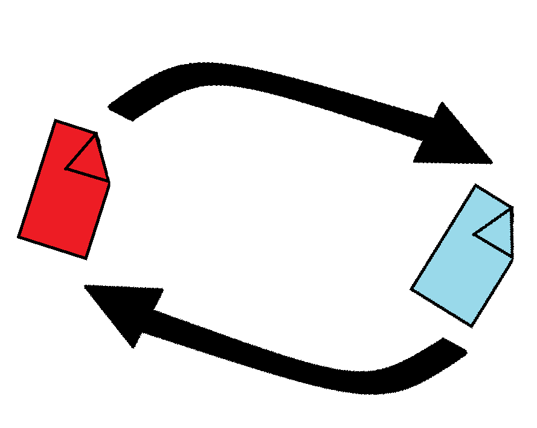

# Local Image Converter



A simple Windows desktop image converter built with C# and Windows Forms. It is designed to provide fast, straightforward image conversion without unnecessary complexity.

The project also serves as a return to hands-on coding after taking a break from project work.

## Why local?

If a task can be completed locally, there is no reason for a server to receive the user's data. This application processes images on the user's computer:

- Images are not uploaded to a remote service.
- Conversion works without an internet connection.
- Users retain control of their files and output location.

## Features

- Convert images to:
  - PNG
  - JPEG
  - BMP
  - GIF
  - TIFF
- Convert multiple images in one operation.
- Add files with a file picker or drag and drop.
- Choose the output folder.
- Adjust JPEG quality from 1 to 100.
- Preserve transparency for formats that support it.
- Avoid overwriting existing files by creating a numbered filename.
- Switch between light and dark mode.
- Display the project logo in the application header.

## Supported input formats

- BMP
- GIF
- JPEG
- PNG
- TIFF

## Requirements

- Windows
- .NET 10 SDK

The application uses Windows Forms and `System.Drawing`, so it targets Windows specifically.

## Running the project

From the project directory:

```powershell
dotnet run
```

## Building a release

```powershell
dotnet build --configuration Release
```

The executable is created at:

```text
bin\Release\net10.0-windows\LocalImageConverter.exe
```

Make sure `logo.png` is distributed alongside the executable. The project automatically copies it to the build output directory.

## Usage

1. Open the application.
2. Select **Add images...**, or drag image files into the window.
3. Choose an output format.
4. If converting to JPEG, set the desired quality.
5. Choose an output folder.
6. Select **Convert images**.

The application creates a new filename when a converted file would otherwise overwrite an existing file.

## Project structure

| File | Purpose |
| --- | --- |
| `main.cs` | Windows Forms application and conversion logic |
| Project file (`*.csproj`) | .NET project configuration |
| `logo.png` | Application logo |

## License

No license has been specified yet.
